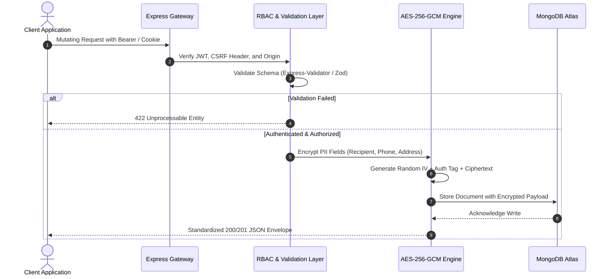
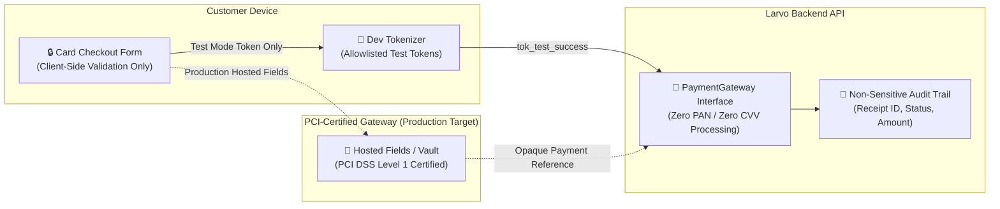

# Larvo E-Commerce

<p align="center">
  <a href="https://github.com/Sasindu003/Larvo/actions/workflows/ci.yml"></a>
  <a href="https://githubmate.ai/analyze?repo=Sasindu003%2FLarvo"></a>
  <a href="#-tech-stack--ecosystem"></a>
  <a href="#-tech-stack--ecosystem"></a>
  <a href="#-security-cryptography--compliance"></a>
  <a href="#-zero-cardholder-payments--pci"></a>
  <a href="docs/VERCEL_ATLAS_GUIDE.md"></a>
</p>

Larvo is a multi-role fashion e-commerce platform engineered for modern retail operations with an integrated customer storefront, supply chain portal, last-mile logistics dispatch, and strict data confidentiality.

---

## Roles & Demo Accounts

Default test password for all seed accounts: `Password123!`

| Role                 | Email                    | Access Scope                                                             |
| :------------------- | :----------------------- | :----------------------------------------------------------------------- |
| **Owner**            | `owner@larvo.com`        | Complete platform governance, financials, and administrative settings    |
| **Admin**            | `admin@larvo.com`        | Store operations, sales analytics, catalog, coupons, and user management |
| **Staff**            | `staff@larvo.com`        | Product editing, inventory review, and customer order management         |
| **Delivery Manager** | `delivery@larvo.com`     | Logistics queue, dispatch routing, and fulfillment tracking              |
| **Supplier**         | `supplier@larvo.com`     | Supplier portal, purchase order fulfillment, and replenishment tracking  |
| **Customer**         | `customer@larvo.com`     | Storefront browsing, cart, checkout, wallet points, and order history    |
| **Test Customer**    | `customer_test@demo.com` | Clean shopper profile for testing checkout flows                         |

---

## Security & PCI DSS Compliance

- **Zero Cardholder Data**: PANs, CVVs, and magnetic stripe data never touch or traverse the Larvo server. Production transactions use hosted fields / vault tokens from certified gateways.
- **AES-256-GCM At-Rest Encryption**: Sensitive personal data (recipient names, telephone numbers, and street delivery addresses) is encrypted at rest using authenticated 256-bit Galois/Counter Mode.
- **Multi-Tier RBAC & CSRF Protection**: Every mutating endpoint enforces strict role validation and CSRF origin guards.
- **Hardened Cookies**: Auth tokens reside in `SameSite: strict`, HTTP-only, SSL-enforced cookies.
- **Private Media Isolation**: Payment slips and sensitive documents in MongoDB GridFS are isolated behind strict role checks returning 404 to unauthorized requests with `Cache-Control: private, no-store`.
- **Test Mode Guardrails**: Built-in payment simulator operates only via deterministic test tokens (`tok_test_success`, `tok_test_decline`) and is strictly disabled in production.
- **Zero Local Disk Writes**: All persistent files, images, and documents stream directly into MongoDB GridFS chunks.

---

## 🛠️ Tech Stack & Ecosystem

### 🎨 Frontend Architecture
<table>
  <tr>
    <td><b>Framework</b></td>
    <td>
      
      
    </td>
    <td>Component-driven SPA architecture with strong type contracts.</td>
  </tr>
  <tr>
    <td><b>Build Tooling</b></td>
    <td>
      
    </td>
    <td>Ultra-fast HMR and optimized production rollup code-splitting.</td>
  </tr>
  <tr>
    <td><b>Design & UI</b></td>
    <td>
      
      
    </td>
    <td>Custom fashion retail design tokens, fully accessible, zero AI-cliché palettes.</td>
  </tr>
  <tr>
    <td><b>State & Routing</b></td>
    <td>
      
      
    </td>
    <td>Role-protected route guards, contextual global state, and dynamic KPI dashboards.</td>
  </tr>
</table>

### ⚙️ Backend & Infrastructure
<table>
  <tr>
    <td><b>Runtime & Server</b></td>
    <td>
      
      
      
    </td>
    <td>Strict TypeScript serverless and long-running runtime with asyncHandler encapsulation.</td>
  </tr>
  <tr>
    <td><b>Database & Storage</b></td>
    <td>
      
      
      
    </td>
    <td>Zero local-disk file writes. Media, documents, and payment slips live strictly in MongoDB GridFS chunks.</td>
  </tr>
  <tr>
    <td><b>Security & Validation</b></td>
    <td>
      
      
      
    </td>
    <td>Military-grade symmetric authenticated encryption for sensitive fields, schema validation pipelines, and strict CORS.</td>
  </tr>
  <tr>
    <td><b>Continuous Delivery</b></td>
    <td>
      
      
    </td>
    <td>Automated pull request regression checks and single-project monorepo deployments.</td>
  </tr>
</table>

---

## 🛡️ Security, Cryptography & Compliance

Larvo follows a **Defense-in-Depth** security philosophy across network, application, and database tiers.



### 🔒 Key Security Controls
* **🔐 AES-256-GCM Field-Level Encryption**: Sensitive personal identification data (recipient names, telephone numbers, and street delivery addresses) is encrypted at rest prior to MongoDB serialization using authenticated 256-bit Galois/Counter Mode.
* **👑 Multi-Tier RBAC Guards**: Endpoints enforce role authorization (`owner`, `admin`, `staff`, `delivery`, `supplier`, `customer`). Elevating privileges or cross-role data leaks are blocked at middleware boundaries.
* **🍪 Hardened Session Protection**: Auth tokens are transmitted via HTTP-only, `SameSite: strict`, and SSL-enforced cookies with double-submit CSRF headers.
* **🛡️ Network & Ingress Security**: Configured with strict reverse proxy trust (`app.set('trust proxy', 1)`), granular CORS whitelisting (preventing wildcard origins), and IP rate limiters defending auth and checkout vectors.
* **📁 Isolated GridFS Assets**: Bank transfer payment slips and private order attachments return `HTTP 404` to unauthenticated users and disallow public CDN caching (`Cache-Control: private, no-store`).

---

## 💳 Zero-Cardholder Payments & PCI

Larvo complies with the strictest payment security standard: **Total Cardholder Data Elimination**.



* **Zero PAN / Zero CVV**: Primary Account Numbers, CVVs, expiration dates, and cardholder security details never traverse or touch the Larvo server.
* **Allowlisted Test Tokens**: The built-in simulator operates exclusively via deterministic test tokens (`tok_test_success`, `tok_test_decline`), instantly rejecting real credit card sequences.
* **Strict Production Guardrails**: The test simulator is automatically turned off in production (`PAYMENT_SIMULATOR_ENABLED=false` and `VITE_PAYMENT_SIMULATOR_ENABLED=false`).
* **Audit & Documentation**: Full data-flow diagrams and audit specifications are maintained in [docs/PCI_SCOPE.md](docs/PCI_SCOPE.md) and [docs/DATA_CLASSIFICATION.md](docs/DATA_CLASSIFICATION.md).

---

## 📦 Core Features & Modules

<table>
  <tr>
    <th width="33%">🛍️ Catalog & Merchandising</th>
    <th width="33%">👛 Checkout & Financials</th>
    <th width="33%">🚚 Supply Chain & Delivery</th>
  </tr>
  <tr>
    <td valign="top">
      <ul>
        <li>Nested departments & category classification.</li>
        <li>Multi-variant inventory tracking (Color, Size, SKU).</li>
        <li>Dynamic tags (Trending, New Arrival, Sale).</li>
        <li>GridFS streaming image storage with zero local storage.</li>
      </ul>
    </td>
    <td valign="top">
      <ul>
        <li>Multi-stage checkout with coupon redemption.</li>
        <li>Store credit digital wallet with refund balance.</li>
        <li>Gamified points loyalty system (Earn & Burn).</li>
        <li>Automated downloadable PDFKit invoices.</li>
      </ul>
    </td>
    <td valign="top">
      <ul>
        <li>Supplier replenishment purchase order (PO) workflow.</li>
        <li>Carrier routing & delivery stage updates.</li>
        <li>Proof-of-delivery upload support.</li>
        <li>Historical order audit trail with timestamps.</li>
      </ul>
    </td>
  </tr>
</table>

---

## 📂 Directory Architecture

```text
Larvo/
├── 📁 .github/                      # CI/CD Workflows (GitHub Actions automated build validation)
├── 📁 client/                       # Frontend SPA (React 18 + Vite 5 + TailwindCSS)
│   ├── 📁 src/
│   │   ├── 📁 api/                  # Axios services, interceptors, and typed API clients
│   │   ├── 📁 components/           # Reusable UI primitives, Modals, Navbar, Footer
│   │   ├── 📁 context/              # Auth, Cart, Theme, and App state providers
│   │   ├── 📁 pages/                # Route components (Storefront, Admin, Supplier, Delivery)
│   │   └── index.css                # Custom theme tokens & Tailwind utility baseline
│   └── package.json
│
├── 📁 server/                       # Backend RESTful API (Express + Mongoose + TypeScript)
│   ├── 📁 src/
│   │   ├── 📁 config/               # Database connection, GridFS buckets, environment validation
│   │   ├── 📁 controllers/          # Modular business logic controllers
│   │   ├── 📁 middleware/           # Auth, RBAC, Rate-limit, ErrorHandler, and Multer GridFS
│   │   ├── 📁 models/               # Mongoose schemas (User, Product, Order, Wallet, Counter)
│   │   ├── 📁 routes/               # Express router endpoints
│   │   ├── 📁 services/             # PDF generation, payment seams, and encryption utils
│   │   ├── 📁 validators/           # Zod & Express-Validator request guards
│   │   └── server.ts                # Application boot, database connection, and graceful shutdown
│   └── package.json
│
├── 📁 docs/                         # Security audits, PCI scopes, and deployment manuals (including VERCEL_ATLAS_GUIDE.md)
├── 📄 start-dev.bat                 # One-click Windows development runner
└── 📄 package.json                  # Root monorepo workspace configuration
```

---

## 🚀 Quick Start

### Prerequisites

- Node.js 18+ or 20+ LTS
- MongoDB 6+ (local or Atlas)
- npm 9+

### 1. Clone & Install

```bash
git clone https://github.com/Sasindu003/Larvo.git
cd Larvo
npm install
```

### 2. Configure Environment

Copy `.env.example` templates in both `server` and `client` workspaces:

```bash
cp server/.env.example server/.env
cp client/.env.example client/.env
```

Generate secure 64-character secrets for `JWT_SECRET` and `ENCRYPTION_KEY`:

```bash
node -e "console.log(require('crypto').randomBytes(64).toString('hex'))"
```

### 3. Seed Database & Start

```bash
# Seed initial data (departments, categories, products, demo accounts)
npm run seed --workspace=server

# Run development servers concurrently
npm run dev
```

Visit **Frontend**: [http://localhost:5173](http://localhost:5173) | **Backend API**: [http://localhost:5000](http://localhost:5000)

---

## Environment Configuration

| Variable                          | Scope  | Description                              | Default / Example               |
| :-------------------------------- | :----- | :--------------------------------------- | :------------------------------ |
| `PORT`                            | Server | Application port                         | `5000`                          |
| `NODE_ENV`                        | Server | Runtime environment                      | `development` / `production`    |
| `MONGO_URI`                       | Server | MongoDB Atlas or local connection string | `mongodb+srv://...`             |
| `JWT_SECRET`                      | Server | Cryptographic token signing key          | `64-char hex`                   |
| `JWT_EXPIRES_IN`                  | Server | Token expiration duration                | `7d`                            |
| `FIELD_ENCRYPTION_KEYS`           | Server | Keyring for AES-256-GCM data encryption  | JSON / comma-separated hex keys |
| `FIELD_ENCRYPTION_ACTIVE_VERSION` | Server | Active version key identifier            | `v1`                            |
| `CLIENT_URL`                      | Server | Allowed CORS origin                      | `http://localhost:5173`         |
| `PAYMENT_SIMULATOR_ENABLED`       | Server | Toggle test payment simulator            | `false` (Prod) / `true` (Dev)   |
| `VITE_API_URL`                    | Client | API endpoint base URL                    | `http://localhost:5000/api`     |

---

## Scripts & Verification

| Command                | Location  | Description                                                        |
| :--------------------- | :-------- | :----------------------------------------------------------------- |
| `npm run dev`          | `root`    | Starts backend and frontend development servers concurrently       |
| `npm run build`        | `root`    | Builds both backend (`tsc`) and frontend Vite bundle               |
| `npm run lint`         | `root`    | Runs ESLint across client and server                               |
| `npm run format:check` | `root`    | Verifies code formatting with Prettier                             |
| `npm test`             | `server/` | Runs comprehensive Jest test suites (14 suites, 104 tests)         |
| `npm run seed`         | `server/` | Populates database with departments, categories, and test products |
| `npm run seed:users`   | `server/` | Seeds pre-configured role-based demo accounts                      |
| `npm run export:local` | `server/` | Exports local MongoDB snapshot to `server/.local/local-data.json`  |
| `npm run import:local` | `server/` | Restores local MongoDB snapshot from export                        |
| `npm run sync:atlas`   | `server/` | Synchronizes local export snapshot into MongoDB Atlas              |
